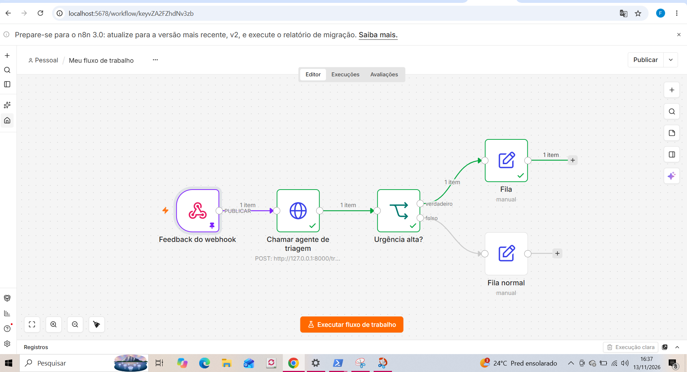

# Triagem de feedbacks com IA (agente + API + automação)

Projeto de portfólio de **Fernanda Letícia da Silva**. Um agente de IA lê o feedback de um cliente de delivery, consulta dados do pedido, classifica o problema, decide a urgência, abre chamado quando é grave e sugere uma resposta. Tudo exposto por uma API e ligado a uma automação no n8n.

## O problema
Times de atendimento recebem milhares de mensagens. Um cabelo na comida e um elogio não podem esperar na mesma fila. Este projeto separa o que é urgente do que não é, e mede se a IA faz isso melhor que uma solução simples sem IA.

## Arquitetura

```
n8n (Webhook) ──► POST /triagem ──► agente ──► Claude (API)
                                       │            │ pede ferramenta
                                       │◄───────────┘
                                       ├─ consultar_pedido(pedido_id)
                                       └─ abrir_chamado(categoria, urgencia, resumo)
                                       ▼
                    {"categoria", "urgencia", "resposta_sugerida"}
                                       ▼
                    n8n: urgência alta? → fila urgente / fila normal
```

| Peça | Arquivo | O que mostra |
|---|---|---|
| Chamada a LLM por API (Claude e Gemini) | `triagem/agente.py` | HTTP direto nas APIs da Anthropic e do Google, sem SDK; o mesmo agente roda nos dois |
| Prompt engineering | `triagem/prompts.py` | papel, categorias fechadas, regras de urgência, exemplos, saída em JSON |
| Agente com ferramentas (tool use) | `triagem/agente.py`, `triagem/ferramentas.py` | loop: modelo pede ferramenta → código executa → devolve resultado → resposta final |
| Validação da saída | `validar()` em `agente.py` | não confia cegamente no modelo; valor inválido vira padrão seguro |
| API sem backend pesado | `triagem/api.py` | `POST /triagem` e `GET /saude`, só biblioteca padrão |
| Automação | `n8n/workflow_triagem.json` | webhook → chama a API → decide pela urgência |
| Baseline sem IA | `triagem/regras.py` | ponto de comparação por palavras-chave |
| Avaliação | `avaliacao.py`, `dados/avaliacao.csv` | 30 casos rotulados à mão, acurácia e latência |
| Testes | `tests/test_triagem.py` | 15 testes sem rede, com Claude e Gemini substituídos por dublês |

## Como rodar

Requer Python 3.10+. **Não instala nada** (só biblioteca padrão).

```bash
# 1. sem chave de API: modo "regras" (baseline)
python -m triagem "Achei um cabelo no hambúrguer do pedido 1001"
python avaliacao.py --modo regras
python -m unittest discover -s tests -v

# 2a. com Claude: exporte a chave (crie em console.anthropic.com; exige saldo)
export ANTHROPIC_API_KEY="sua-chave"        # Windows PowerShell: $env:ANTHROPIC_API_KEY="sua-chave"
python -m triagem "Pedi há 2 horas e o pedido 1003 não chegou"
python avaliacao.py --modo llm

# 2b. com Gemini: chave gratuita em aistudio.google.com (só conta Google, sem cartão)
export GEMINI_API_KEY="sua-chave"           # Windows PowerShell: $env:GEMINI_API_KEY="sua-chave"
python -m triagem "Pedi há 2 horas e o pedido 1003 não chegou"
python avaliacao.py --modo gemini --pausa 5   # a pausa evita estourar o limite gratuito

# 3. API
python -m triagem.api                        # http://localhost:8000
curl -X POST localhost:8000/triagem -H "Content-Type: application/json" \
     -d '{"texto": "Fui cobrado duas vezes no cartão"}'
```

### n8n
1. Suba o n8n (por exemplo `docker run -it --rm -p 5678:5678 n8nio/n8n`) e deixe `python -m triagem.api` rodando.
2. No n8n: *Workflows → Import from file* → `n8n/workflow_triagem.json`.
3. Se o n8n roda em Docker, a URL `host.docker.internal:8000` já aponta para a sua máquina; se rodar direto no computador, troque por `localhost`.
4. Ative o workflow e envie `POST` para a URL do webhook com `{"texto": "..."}`.
5. Troque os nós *Fila urgente* / *Fila normal* por Slack, Google Sheets ou e-mail.

Testado em 13/11/2026 num n8n local: o webhook recebeu `{"texto": "Achei um cabelo no hamburguer do pedido 1001"}`, chamou a API e o caso foi para a fila urgente. Esta execução usou o **modo regras** (API sem chave de IA). A URL do nó HTTP precisa ser `http://127.0.0.1:8000/triagem` quando o n8n roda direto no computador.


## Resultados

Gabarito: 30 feedbacks escritos e rotulados por mim, de propósito com casos difíceis (ex.: *"Não demorou nada, amei"* contém "demorou" mas é elogio).

| Abordagem | Categoria | Urgência | Ambas | Latência média |
|---|---|---|---|---|
| Regras (sem IA) | 83% | 83% | 73% | ~0 s |
| **Agente com Gemini** (`gemini-3.1-flash-lite`) | **100%** | **93%** | **93%** | ~9,5 s por caso |
| Agente com Claude | não rodei ao vivo (sem saldo na API); só testes com dublê | | | |

Erros do baseline: ele não entende negação (*"não demorou nada"*), cai em "outro" quando falta a palavra-chave (*"inseto"*, *"sem gosto"*) e não sabe que "uma hora e meia" passa de 60 minutos. É onde se espera ganho do LLM.

### Leitura dos resultados (Gemini, duas rodadas em 12/11/2026)
- **Rodada 1:** 1 dos 30 casos (#26) falhou por erro 503 da API do Google (alta demanda) e foi contado como erro. Nos 29 casos avaliados: categoria 29/29, urgência e ambas 28/29. Em vez de esconder, ajustei o código para tentar mais vezes nesse erro.
- **Rodada 2 (a da tabela):** 0 falhas. Categoria 30/30; urgência e ambas 28/30.
- **Erro #16** ("Veio sem talheres"): gabarito *baixa*, previsto *média*. Meu prompt só define *baixa* para elogios e incômodos que o cliente diz estar tudo bem; talher faltando não entra nisso. A resposta do modelo é defensável, e o ponto fraco é a regra ambígua no meu prompt e no meu gabarito.
- **Erro #26** ("quase 1 hora de atraso"): gabarito *média*, previsto *alta*. O prompt manda *alta* acima de 60 minutos; o modelo escalou por cautela. Em triagem um falso alarme custa menos que um caso grave esquecido, mas continua sendo erro.
- **Efeito da IA:** acerto de categoria e urgência juntas foi de 73% (regras) para 93% (Gemini), principalmente em negação ("não demorou nada"), palavras fora da lista ("inseto") e raciocínio numérico ("uma hora e meia").

## Decisões e limitações (honestas)
- **Resultados de uma pessoa e de poucas rodadas.** Prompt e gabarito compartilham as mesmas definições, o que tende a deixar o resultado otimista; mesmo com temperatura 0 o modelo pode variar entre rodadas.
- **Conjunto de avaliação pequeno e sintético.** 30 casos mostram o método, não provam desempenho em produção. O próximo passo seria usar feedbacks reais anonimizados e mais casos.
- **Gabarito de uma pessoa só.** Os rótulos são minhas decisões; duas pessoas poderiam discordar em casos de borda.
- **Dados de pedido fictícios.** `dados/pedidos.json` simula um sistema interno.
- **Claude e Gemini implementados.** O que muda entre provedores é só o formato das mensagens e das ferramentas; trocar para GPT seria o mesmo exercício.
- **Camada gratuita do Gemini usa seus prompts para treinar os modelos do Google.** Por isso o projeto só usa feedbacks fictícios; nunca envie dados reais de clientes por ela.
- **Sem autenticação na API.** Ok para demonstração local, não para produção.
- **Chave de API fora do código.** Vem de variável de ambiente; `.env` está no `.gitignore`.
- **A IA não decide reembolso.** O prompt proíbe prometer; a decisão é humana.

## Como este projeto foi construído
Foi desenvolvido com apoio de uma IA (Claude) e revisado por mim. _Escreva aqui, com suas palavras, o que você alterou ou testou por conta própria (ver "Próximos passos")._

## Próximos passos
- [ ] Rodar `--modo gemini` (ou `--modo llm`) e preencher a tabela de resultados.
- [ ] Abrir o projeto no Cursor ou Replit e pedir uma melhoria pequena (ex.: exportar resultados em CSV, ou um novo teste). Registrar o prompt usado e o que você ajustou.
- [ ] Adicionar 10 casos seus ao `dados/avaliacao.csv` e comparar de novo.
- [ ] Importar o workflow no n8n e tirar um print dele funcionando.
